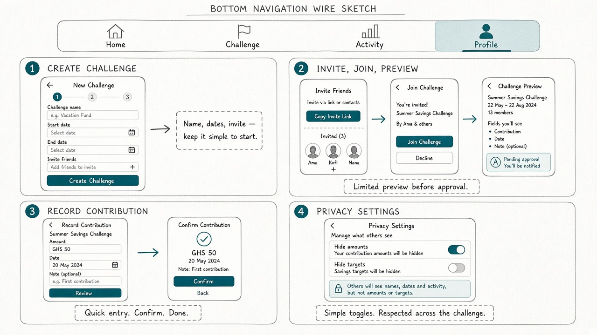

# Gate 2.2 — Lightweight navigation & flow sketches

| Field | Value |
| --- | --- |
| Gate | 2.2 — Visual Identity Exploration |
| Fidelity | Lightweight sketches — **not** wireframe package / mid-fi |
| IA labels | Working proposals only |
| Transition grammar | Informed by Wise-like “new vs continuation” (creative) |

---

## 1. Visual sketch



---

## 2. Working mobile shell (proposal)

| Tab | Job | Notes |
| --- | --- | --- |
| Home | Personal status + active challenges | Answers “how am I doing?” first |
| Challenge | Deep context: roster, totals, rules | First-class, not buried |
| Activity | Event-generated feed | Privacy-filtered |
| Profile | Settings, privacy, account | Includes pause / target entry points |

Exact labels and tab count — **OPEN — requires product-owner approval.**

Desktop = same IA, denser panes — not a second product model (PRS §15 Mobile First).

---

## 3. Flow sketches

Transition cue (creative): **upward / new sheet** = new task; **sideways** = continuation within a task; **sheet** = supplementary edit.

### 3.1 Create challenge

```
Home → Create (new)
  → Name + description
  → Start / end dates + time zone
  → Review → Draft / Scheduled (G1.1-02)
  → Optional: invite friends
  → Owner may defer personal target / weekly commitment (G1.1-01, G1.1-03, G1.1-04)
```

Owner without activated savings participation is **not** assessed for missed commitments (G1.1-01).

Activation conditions detail — **OPEN — requires product-owner approval** (Gate 1.1 remaining opens).

### 3.2 Invite / join

```
Owner: Challenge → Invite → share private link (expires 7 days default — G1.1-14)
Invitee preview (G1.1-07) may show ONLY:
  name · description · start · end · participant count
Must NOT show: targets, amounts, financial totals, member financial activity
→ Request join → Owner approval → Financial privacy acknowledgement
→ Configure personal target + weekly commitment before recording savings
```

### 3.3 Record contribution

```
Home / Challenge → Record savings (primary)
  → Amount + date (within permitted period)
  → Confirm (eligibility rules — G1.1-05)
  → Success (see screens-contribution-confirm.md)
  → Updates: personal progress, commitment assessment, milestones, activity (privacy-aware)
```

Backdating / allocation across weeks — **OPEN — requires product-owner approval** (do not invent).

### 3.4 Privacy settings

```
Profile → Privacy
  → Toggle: share monetary information
  → Explainer: hides amounts AND target from others;
    excludes you from others’ visible aggregates (G1.1-06)
  → Preview: how roster / totals appear to friends
  → Save → applied across feed, exports, notifications (server-side enforcement in product)
```

Self always sees own authorised financial information.

---

## 4. Hierarchy reminder across flows

| Moment | Personal progress | Weekly commitment | Shared activity |
| --- | --- | --- | --- |
| Home | Primary | Primary strip | Preview |
| Challenge | In roster row | Strip / history | Full feed |
| After contribution | Updated hero | Chip state | New event |

---

## 5. Explicit non-advance

These sketches stop at exploration. **No wireframes / mid-fidelity system work** until PO approves a visual direction (`decision-summary.md`).
