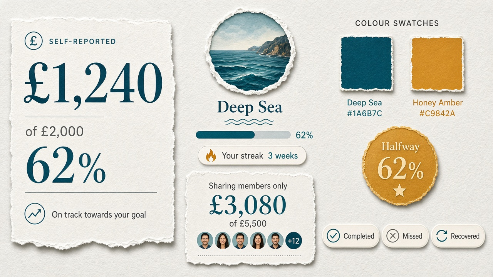

# Gate 2.2 — Moodboard A+B: Clear Companions × Crew Momentum

| Field | Value |
| --- | --- |
| Gate | 2.2 — Visual Identity Exploration |
| Status | **Direction approved (A+B)** — correction pack |
| Territory | **Approved primary** — A (financial clarity) + B (social motivation) |
| Authority | Creative system for later gates — logo / final palette / type still **open** |
| Accessibility | Plans against PRS §10.1 — **WCAG 2.2 AA** (planned; verify pairs) |
| Sample data | Synthetic · labelled self-reported · reconciled set |

---

## 1. Intent

Combine **Clear Companions (A)** amount hierarchy, calm chrome, and honest labelling with **Crew Momentum (B)** challenge energy, streak-before-feed sequencing, and milestone recognition.

Informed by fintech clarity + social accountability research without cloning competitor brands (`docs/design/research/opportunities.md`).

---

## 2. Canonical sample content (identical on A+B and C)

| Element | Value |
| --- | --- |
| Challenge | Portugal 2027 |
| Purpose line | Save together for the trip |
| Viewer | Alex (you) |
| Personal progress | **£1,240 of £2,000** · 62% · **Self-reported** |
| Weekly commitment | **£50** · Completed this week |
| Streak (baseline) | **3 weeks** |
| Sharing-member total | **£3,080 of £5,500** · **Sharing members only** (whose figures are included) |
| Audience default | Monetary info visible to **approved challenge members** by default; **opt-out** hides amounts **and** target (G1.1-06) |
| Sharing roster | Alex £1,240/£2,000 · Sam £980/£1,500 · Riley £860/£2,000 |
| Opted out | Jordan — **one** privacy control hides amounts **and** target |
| Milestone in view | Alex “Halfway to target” (50%) — consistent with £1,240/£2,000 = **62%** (G1.1-08) |

Personal figures and sharing-member aggregates are always labelled separately. Do **not** describe amounts/targets as “private by default.”

---

## 3. Visual artifacts

*Overview — personal £1,240 of £2,000 (**62%**), Honey Amber **`#C9842A`**, sharing-members-only total, Your streak. Privacy (in copy, not as “private by default”): visible to **approved challenge members** by default; opt-out hides amounts and target; visible totals include **sharing members only**.*

*Type + colour roles study.*

Related screen studies: `screens-dashboard.md`, `screens-challenge-activity.md`, `screens-contribution-confirm.md`.

---

## 4. Working visual system (accents working only — unlocked)

> Logo, final palette, type licensing, and identity tokens remain **open**.

### 4.1 Colour roles (working exploration tokens)

| Role | Working token | Hex (study) | Use |
| --- | --- | --- | --- |
| Paper | `surface.paper` | `#F5F7FA` | App background (cool paper — not cream `#F4F1EA`) |
| Elevated | `surface.elevated` | `#FFFFFF` | Primary content plane |
| Ink | `text.primary` | `#142033` | Primary amounts and titles |
| Mute | `text.secondary` | `#5A6577` | Labels, captions, “self-reported” |
| Deep Sea | `action.primary` | `#1A6B7C` | Primary CTAs, focus rings, calm progress fill (**working accent**) |
| Honey Amber | `accent.crew` | `#C9842A` | Scarce crew/milestone energy only (**working accent**) |
| Success | `status.success` | `#2D7A4F` | Completed commitment (always with icon + text) |
| Caution | `status.caution` | `#A65D1A` | Missed week (always with icon + text) |
| Privacy | `status.privacy` | `#5A6577` | Private member chip + lock |

**Honey Amber contrast (qualified):** Treat as a **planned WCAG 2.2 AA** verification item — do **not** claim AA for amber-on-paper or amber-on-white body text. Prefer amber for scarce marks/icons; keep readable money and body copy in Ink/Mute on Paper. Interactive prototype must verify all amber pairs against PRS §10.1.

**Deliberate non-clones:** not Monzo coral, Wise bright green, Strava orange, Trading 212 cyan, or AllTrails neon green. Not purple-gradient SaaS; not cream + terracotta serif defaults.

### 4.2 Typography hierarchy (families recommended, not locked)

| Tier | Role | Working recommendation | Notes |
| --- | --- | --- | --- |
| Celebration display | Milestones, streak moments | **Syne** (or similar) | Short strings only · **not final** |
| UI sans | Chrome, body, chips | **Manrope** | **not final** |
| Financial numerals | GBP amounts | Tabular lining figures | Largest element when money is present |

**Hierarchy order on money screens (A foundation):**

1. Primary **personal** amount (what · whose)  
2. Context labels — self-reported · privacy scope (G1.1-06)  
3. Commitment status this week (B strip)  
4. **Sharing-member** total (never implied as full group)  
5. Crew activity (B rhythm)

### 4.3 Spacing

- Base rhythm: **4 / 8 / 16 / 24 / 40**
- Thumb-reach primary CTA in lower third on mobile
- Generous quiet around primary amount (Trust Before Decorations — PRS §15)

### 4.4 Progress indicators

| Signal | Treatment (A+B) | Maps to |
| --- | --- | --- |
| Personal % of target | Calm horizontal track + % caption (A) | Personal progress; G1.1-08 milestones |
| Weekly commitment | Icon + text chip: Completed / Missed / Paused / Not started (B) | G1.1-03; miss G1.1-09; pause state G1.1-11 |
| Streak | Compact strip above feed (B) | Streaks; recovery automatic (G1.1-09) |
| Sharing-member group | Secondary track, explicitly labelled | G1.1-06 |
| Milestone | Named mark (e.g. Halfway) with scarce amber | G1.1-08 |

Paused is a **status chip only** here. Max pause duration and resume behaviour are **OPEN — requires product-owner approval** — not invented in this study.

### 4.5 Status treatments

Always **icon + text** (never colour alone — planned WCAG 2.2 AA / PRS §10.1):

| State | Chip pattern | Rule ID | Tone |
| --- | --- | --- | --- |
| Completed | Check + “Completed this week” | G1.1-03 | Calm success |
| Missed | Alert + “Missed” (historical) | G1.1-09 | Honest, non-shaming |
| Recovered | Refresh + “New streak started” | G1.1-09 | Supportive |
| Paused | Pause + “Paused” | G1.1-11 | Distinct from missed/completed; no invented resume UI |
| Private | Lock + “Private” | G1.1-06 | Person visible; amounts **and** target hidden via **one** control |

### 4.6 Milestone feedback tone

- Named, rule-transparent (“Halfway to target — 50% of your £2,000”)
- Celebrate consistency against **own** commitment/target — not comparative wealth
- Privacy governs what others see about milestone activity (G1.1-08)

### 4.7 Motion personality (planned; needs interactive prototype)

- Soft progress fill on contribution (A)
- Snappier success pulse on commitment complete / milestone (B)
- Honour `prefers-reduced-motion` with static equivalents (PRS §10.1)

---

## 5. Privacy control (G1.1-06)

**Default:** monetary information (amounts and target) is visible to **approved challenge members**.

**One** opt-out control: hide monetary information.

- When opted out: hides **both** reported amounts **and** individual target from other approved members  
- Opted-out members are excluded from **sharing members only** aggregates  
- Self always sees own authorised financials  
- Do **not** say “private by default”  
- Do **not** show separate amount vs target toggles  
- Wording: **approved challenge members** = audience; **sharing members only** = whose figures enter the visible total  

---

## 6. Optional exploration only — not MVP

One-tap **Encourage** / kudos-analogue may appear on studies.

**Label required:** *Optional exploration only — not MVP.*

---

## 7. Open items

- Final type licensing and palette lock — **OPEN — requires product-owner approval.**  
- Progress metaphor lock (bar vs ring vs track) — **OPEN — requires product-owner approval.**  
- Pause duration / resume — **OPEN — requires product-owner approval.**  
- Optional Encourage beyond exploration — **OPEN — requires product-owner approval** (still **not MVP**).

---

## 8. Provenance

- `docs/design/research/opportunities.md` (A+B hybrid)
- `docs/design/research/design-principles.md`
- `docs/product/specification-v1.md` §15, §10.1 (read-only)
- `docs/product/amendments/gate-1-1-product-rules.md` (read-only)
