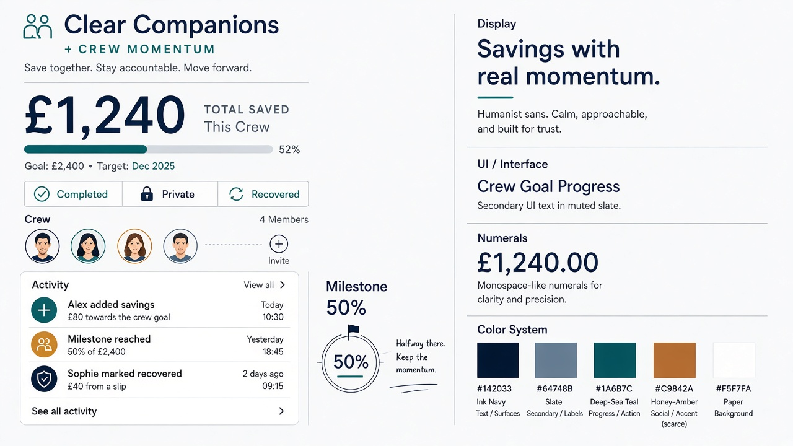
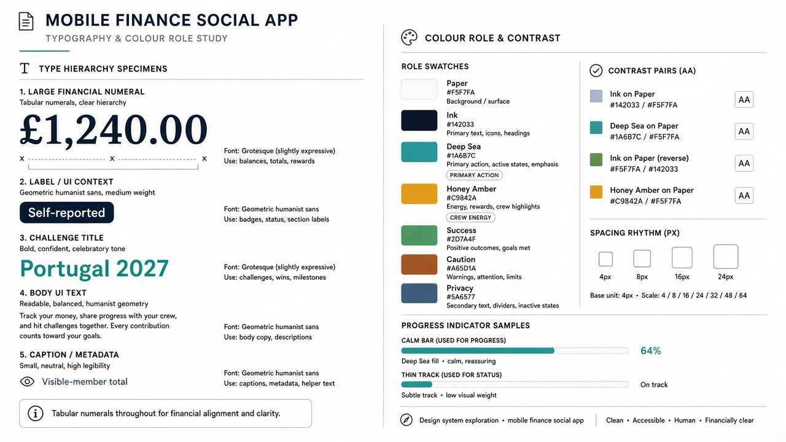

# Gate 2.2 — Moodboard A+B: Clear Companions × Crew Momentum

| Field | Value |
| --- | --- |
| Gate | 2.2 — Visual Identity Exploration |
| Status | Ready for product-owner direction review |
| Territory | **Primary exploration** — A (financial clarity) + B (social motivation) hybrid |
| Authority | Creative study only — not a final identity; does not amend Gate 1 / 1.1 |
| Accessibility | Plans against PRS §10.1 — **WCAG 2.2 AA** |
| Sample data | Synthetic · labelled self-reported |

---

## 1. Intent

Combine **Clear Companions (A)** amount hierarchy, calm chrome, and honest labelling with **Crew Momentum (B)** challenge energy, streak-before-feed sequencing, and milestone recognition.

Informed by fintech clarity analogs (Monzo / Wise / Trading 212 patterns) and social accountability analogs (Strava / AllTrails patterns) without cloning competitor brand systems (`docs/design/research/opportunities.md` §5).

---

## 2. Shared sample content (identical on A+B and C)

Use this content on every comparable study in Gate 2.2:

| Element | Value |
| --- | --- |
| Challenge | Portugal 2027 |
| Purpose line | Save together for the trip |
| Viewer | Alex (you) |
| Personal progress | £1,240 of £2,000 · 62% · **Self-reported** |
| Weekly commitment | £50 |
| Streak (baseline) | 3 weeks |
| Visible-member total | £4,180 of £8,500 · **Visible members only** |
| Members | Alex (you), Sam, Riley, Jordan (**Private**) |
| Milestone in view | 50% — “Halfway to target” (G1.1-08) |

---

## 3. Visual artifacts

*Overview board — amount hierarchy, status chips, progress, crew presence.*

*Type + colour roles study.*

Related screen studies: `docs/design/exploration/screens-dashboard.md`, `screens-challenge-activity.md`, `screens-contribution-confirm.md`.

---

## 4. Working visual system (recommendation only — unlocked)

> Final logo, palette, type licensing, and identity tokens remain **open** pending PO approval.

### 4.1 Colour roles (proposed exploration tokens)

| Role | Working token | Hex (study) | Use |
| --- | --- | --- | --- |
| Paper | `surface.paper` | `#F5F7FA` | App background (cool paper — not cream `#F4F1EA`) |
| Elevated | `surface.elevated` | `#FFFFFF` | Primary content plane |
| Ink | `text.primary` | `#142033` | Primary amounts and titles |
| Mute | `text.secondary` | `#5A6577` | Labels, captions, “self-reported” |
| Deep Sea | `action.primary` | `#1A6B7C` | Primary CTAs, key focus rings, calm progress fill |
| Honey Amber | `accent.crew` | `#C9842A` | Scarce crew/milestone energy (not large fills behind money) |
| Success | `status.success` | `#2D7A4F` | Completed commitment (always with icon + text) |
| Caution | `status.caution` | `#A65D1A` | Missed week (always with icon + text) |
| Privacy | `status.privacy` | `#5A6577` | Private member chip + lock |

**Deliberate non-clones:** not Monzo coral, Wise bright green, Strava orange, Trading 212 cyan, or AllTrails neon trail green. Not purple-gradient SaaS; not cream + terracotta serif defaults.

### 4.2 Typography hierarchy (families recommended, not locked)

| Tier | Role | Working recommendation | Notes |
| --- | --- | --- | --- |
| Celebration display | Milestones, streak moments | **Syne** (or similar expressive grotesque) | Short strings only |
| UI sans | Chrome, body, chips | **Manrope** | Warm humanist; avoid Inter-as-brand |
| Financial numerals | GBP amounts | Manrope / tabular lining figures | Largest element when money is present |

**Hierarchy order on money screens (A foundation):**

1. Primary amount (what)
2. Context labels — whose · self-reported · visibility scope (G1.1-06)
3. Commitment status this week (B strip)
4. Visible-member total (never implied as full group)
5. Crew activity (B rhythm)

### 4.3 Spacing

- Base rhythm: **4 / 8 / 16 / 24 / 40**
- Thumb-reach primary CTA in lower third on mobile
- Generous quiet around primary amount (Trust Before Decorations — PRS §15)

### 4.4 Progress indicators

| Signal | Treatment (A+B) | Maps to |
| --- | --- | --- |
| Personal % of target | Calm horizontal track + % caption (A) | GOAL progress; G1.1-08 milestones |
| Weekly commitment | Icon + text chip: Completed / Missed / Paused / Not started (B) | G1.1-03, G1.1-09, G1.1-11 |
| Streak | Compact strip above feed (B sequencing) | GAME streaks; recovery automatic |
| Visible-member group | Secondary track, explicitly labelled | G1.1-06 |
| Milestone | Named mark (e.g. Halfway) with scarce amber accent | G1.1-08 |

### 4.5 Status treatments

Always **icon + text** (never colour alone — WCAG 2.2 AA / PRS §10.1):

| State | Chip pattern | Tone |
| --- | --- | --- |
| Completed | Check + “Completed this week” | Calm success |
| Missed | Alert + “Missed” (historical) | Honest, non-shaming |
| Recovered | Refresh + “New streak started” | Supportive (G1.1-09) |
| Paused | Pause + “Paused” | Distinct from missed/completed (G1.1-11) |
| Private | Lock + “Private” | Person remains visible; amounts/targets hidden (G1.1-06) |

### 4.6 Milestone feedback tone

- Named, rule-transparent (“Halfway to target — 50% of your £2,000”)
- Celebrate consistency against **own** commitment/target — not comparative wealth (Reward Meaningful Progress)
- Privacy governs what others see about milestone activity (G1.1-08)

### 4.7 Motion personality (planned; needs interactive prototype)

- Soft progress fill on contribution (A)
- Snappier success pulse on commitment complete / milestone (B)
- Honour `prefers-reduced-motion` with static equivalents (PRS §10.1)

---

## 5. Optional exploration only — not MVP

A one-tap **Encourage** / kudos-analogue may appear on contribution success or activity rows in studies.

**Label required wherever shown:** *Optional exploration only — not MVP.*

Does not expand frozen product scope (`docs/design/research/design-principles.md` P6).

---

## 6. Principle checklist (Gate 2.1 §3)

| Check | A+B study |
| --- | --- |
| Trust | Primary £ amount dominates |
| Social | Challenge + activity inside core surfaces |
| Consistency | Streak / commitment / milestones over wealth rank |
| Distinctive | Deep Sea + Honey Amber; cool paper; Syne/Manrope recommendation |
| Accessible | Contrast roles + non-colour status planned for WCAG 2.2 AA |
| Mobile first | Single-column hierarchy; bottom nav in flows study |
| Spec-safe | No new product requirements; optional kudos labelled |

---

## 7. Open items

- Exact type licensing and final accent — **OPEN — requires product-owner approval.**
- Progress metaphor lock (bar vs ring vs track) — **OPEN — requires product-owner approval.**
- Whether optional Encourage control proceeds beyond moodboard — **OPEN — requires product-owner approval** (and is **not MVP** even if explored).

---

## 8. Provenance

- `docs/design/research/opportunities.md` (A+B hybrid priority)
- `docs/design/research/design-principles.md`
- `docs/design/research/competitor-analysis.md`
- `docs/product/specification-v1.md` §15, §10.1 (read-only)
- `docs/product/amendments/gate-1-1-product-rules.md` (read-only)
