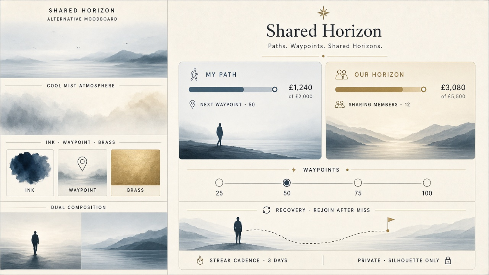

# Gate 2.2 — Moodboard C: Shared Horizon (retained alternative)

| Field | Value |
| --- | --- |
| Gate | 2.2 — Visual Identity Exploration |
| Status | **Retained alternative + reference** (A+B is approved primary) |
| Role | Reference for distinguishing **personal** vs **sharing-member** progress |
| Accessibility | Plans against PRS §10.1 — **WCAG 2.2 AA** |
| Sample data | Same reconciled synthetic set as A+B · self-reported |

---

## 1. Intent

Preserve **Shared Horizon** as metaphor-led alternative and labelling reference: *My path* (personal) beside *Our horizon* (sharing-member aggregates). Not discarded; not the approved primary chrome system.

---

## 2. Canonical sample content (identical to A+B)

| Element | Value |
| --- | --- |
| Challenge | Portugal 2027 |
| Personal progress | **£1,240 of £2,000** · 62% · **Self-reported** |
| Weekly commitment | **£50** · Completed · streak **3 weeks** |
| Sharing-member total | **£3,080 of £5,500** · **Sharing members only** |
| Members | Alex, Sam, Riley sharing · Jordan **Private** (amounts **and** target) |
| Milestone | 50% — “Halfway to target” (G1.1-08) |

---

## 3. Visual artifacts

Comparable dashboard: see `screens-dashboard.md` and `media/gate-2-2/screen-dashboard-c.jpg`.

---

## 4. Working visual system (recommendation only — unlocked)

### 4.1 Colour roles

| Role | Hex (study) | Use |
| --- | --- | --- |
| Mist atmosphere | cool blue-grey | Behind content — contrast planned for WCAG 2.2 AA |
| Path Ink | `#1B2430` | Amounts, titles |
| Waypoint Brass | `#8B7340` | Scarce milestone / CTA accent |
| Horizon Mute | `#5C6B7A` | Labels, visibility captions |

### 4.2 Progress indicators

| Signal | Treatment (C) | Rule |
| --- | --- | --- |
| Personal target | Path with waypoints 25 / 50 / 75 / 100% | G1.1-08 |
| Sharing-member total | Parallel “horizon” track, labelled | G1.1-06 |
| Weekly commitment | Cadence chip | G1.1-03 |
| Recovery | Rejoin — new streak after miss; miss stays historical | G1.1-09 |
| Paused | Distinct cadence break **status only** — no invented duration/resume | G1.1-11 |

### 4.3 Status & privacy

- Same state vocabulary as A+B with icon + text  
- **One** monetary privacy control hides amounts **and** target (G1.1-06)  
- Dual labels make personal vs sharing-member aggregates unmistakable  

---

## 5. Risks

- Metaphor must not decorate over money (Trust Before Decorations)  
- Atmosphere must not reduce contrast below **planned** WCAG 2.2 AA  

---

## 6. Open items

- How much C labelling to borrow into A+B chrome — **OPEN — requires product-owner approval** for wireframe stage.  
- Pause duration / resume — **OPEN — requires product-owner approval.**

---

## 7. Provenance

Same Gate 1 / 1.1 / research sources as `moodboard-ab.md` (read-only).
