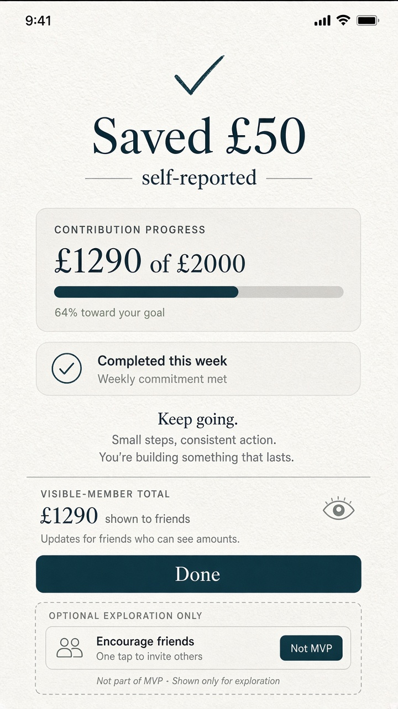

# Gate 2.2 — Static study: Contribution confirmation (mobile)

| Field | Value |
| --- | --- |
| Gate | 2.2 — Visual Identity Exploration |
| Fidelity | Static visual study |
| Direction | A+B approved |
| Sample data | Reconciled synthetic · self-reported |

---

## 1. Intent

Confirm an eligible self-reported contribution with fintech clarity and social warmth, without implying bank custody.

---

## 2. Visual study — A+B

### Hierarchy (reconciled beat)

1. **Confirmation amount** — Saved **£50** · **Self-reported**  
2. **Personal progress** — now **£1,240 of £2,000** (from £1,190)  
3. **Weekly commitment** — Completed this week (icon + text) · streak **3 weeks**  
4. Supportive, non-punitive copy  
5. Note that **sharing-member** totals update for friends who share monetary information (G1.1-06) — distinct from personal figures  
6. Primary **Done** CTA (Deep Sea)

### Tone

- Soft confirmation (A) + clear success (B)  
- No vault / banking-terminal chrome  
- Milestone uses scarce Honey Amber only when a threshold is crossed (G1.1-08)  
- No invented pause/resume behaviour on this screen  

---

## 3. Optional exploration only — not MVP

**Encourage friends** one-tap, if shown: *Optional exploration only — not MVP.*

---

## 4. Accessibility notes (planned)

- Success must not rely on colour alone  
- Focus to confirmation / Done — **needs interactive prototype**  
- Motion: short fill/pulse with reduced-motion static check (PRS §10.1)  
- Honey Amber on any success chrome: **planned WCAG 2.2 AA check** — do not overclaim  

---

## 5. Open

- Exact post-confirm navigation — **OPEN — requires product-owner approval.**  
- Whether Encourage appears beyond exploration — **OPEN — requires product-owner approval** (still not MVP).
