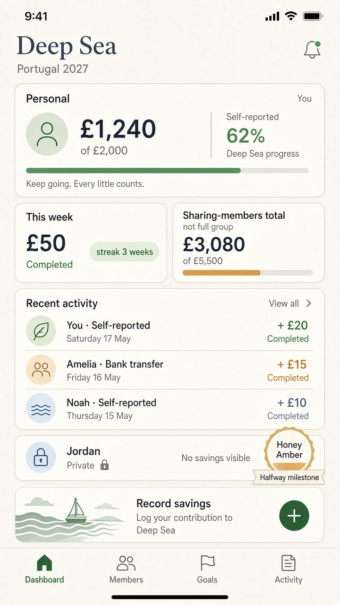
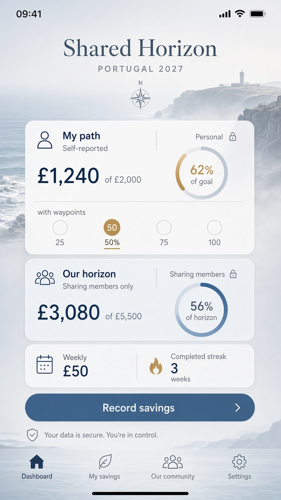

# Gate 2.2 — Static study: Challenge dashboard (mobile)

| Field | Value |
| --- | --- |
| Gate | 2.2 — Visual Identity Exploration |
| Fidelity | Static visual study — **not** wireframes / mid-fi |
| Direction | **A+B approved**; C retained as comparable reference |
| Sample data | Reconciled synthetic · self-reported |

---

## 1. Hierarchy (must read in this order)

1. **Personal progress** — £1,240 of £2,000 · Self-reported  
2. **Weekly commitment** — £50 · Completed + streak **3 weeks**  
3. **Sharing-member total** — £3,080 of £5,500 · labelled **Sharing members only** (G1.1-06)  
4. **Shared activity preview** — event-generated, privacy-respecting  

Personal figures and sharing-member aggregates are never conflated.

---

## 2. Primary study — A+B (approved)

**Clear Companions (A)** — large calm personal amount; Deep Sea progress; quiet chrome.  
**Crew Momentum (B)** — commitment/streak strip before activity; Honey Amber only on Halfway mark.  
**Privacy** — Jordan **Private** (amounts **and** target hidden by one control — G1.1-06).

---

## 3. Comparable study — Shared Horizon (C, retained)

Same sample content. Dual composition: **My path** vs **Our horizon (sharing members)**.

---

## 4. Annotations

| Region | Design intent | Product rule |
| --- | --- | --- |
| Hero personal amount | Trust Before Decorations | Self-reported |
| Commitment chip | Habit loop clarity | G1.1-03 |
| Sharing-member total | Explicit aggregate scope | G1.1-06 |
| Halfway mark | Named personal milestone | G1.1-08 |
| Private roster presence | Person ≠ missing data | G1.1-06 |
| Record savings CTA | Primary thumb action | Approved MVP contribution |

No invented pause duration / resume UI on this screen.

---

## 5. Open

- Final progress control (bar vs path/waypoints) — **OPEN — requires product-owner approval.**  
- Exact IA labels — see `flows-navigation.md` — **OPEN — requires product-owner approval.**
