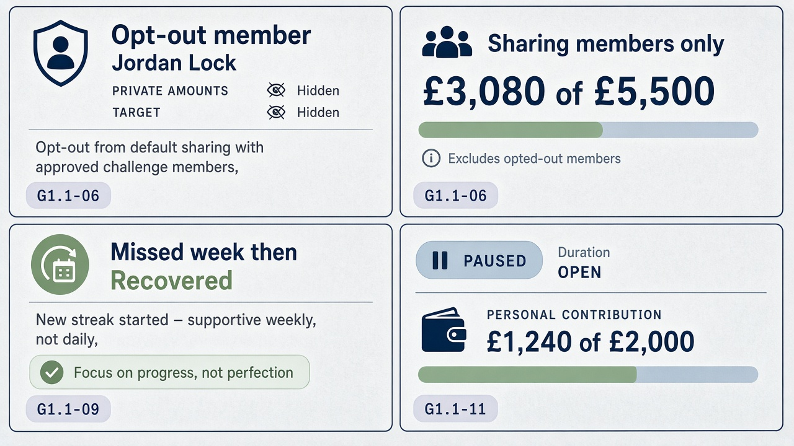

# Gate 2.2 — State & accessibility review

| Field | Value |
| --- | --- |
| Gate | 2.2 — Visual Identity Exploration |
| Accessibility target | PRS §10.1 — **WCAG 2.2 AA** (planned checks; do not overclaim) |
| Sample data | Reconciled synthetic · **Self-reported** |
| Interactive prototype | Not in this gate — flagged below |

---

## 1. State panel artifact

---

## 2. Critical UI states (viewer visibility)

Shared cast: **Portugal 2027** · Viewer **Alex** · Alex / Sam / Riley sharing · **Jordan private** · self-reported.

Canonical figures: personal **£1,240 of £2,000** · streak **3** (baseline screens) · sharing-member total **£3,080 of £5,500**.

### 2.1 Opted-out member (Jordan) — G1.1-06

| Aspect | Treatment |
| --- | --- |
| Default | Amounts and target visible to **approved challenge members** |
| Privacy control | **One** opt-out: hide monetary information (not “private by default”) |
| Effect | Hides **both** amounts **and** individual target from other approved members |
| What Alex sees | Jordan name/avatar + **Private** lock · no amount · no target |
| What Jordan sees (own) | Full own financials |
| Aggregates | Jordan excluded from **sharing members only** totals |
| Design guard | Person remains in roster — not a data hole; no inference affordances |

### 2.2 Sharing-member total — G1.1-06

| Aspect | Treatment |
| --- | --- |
| Rule ID | **G1.1-06** (not G1.1-08) |
| Label | **Sharing members only** (whose figures are included — never bare “Group total”) |
| Audience term | **Approved challenge members** (who may see shared monetary info by default) |
| Sample | **£3,080 of £5,500** (= Alex+Sam+Riley; excludes Jordan) |
| Distinction | Separate from **personal** £1,240 of £2,000 |
| Helper | “Excludes members who opted out of sharing amounts and targets.” |

### 2.3 Missed → recovered commitment — G1.1-09

| Aspect | Treatment |
| --- | --- |
| History | Missed week remains **Missed** |
| Next success | **Recovered / New streak started** — automatic; no manual reset |
| Tone | Supportive, non-punitive |
| Must not | Retroactively rewrite miss unless authorised correction changes that period |
| Note | Recovery panel is a **scenario**; baseline screens keep streak **3** |

### 2.4 Paused commitment — G1.1-11 (status only)

| Aspect | Treatment |
| --- | --- |
| Chip | **Paused** — distinct from Completed and Missed (icon + text) |
| Product fact | Pauses are prospective; paused weeks ≠ completed or missed |
| **Removed from studies** | Invented max pause duration, resume flows, auto-resume rules |
| Open | Duration and resume behaviour — **OPEN — requires product-owner approval** |

### Related milestone — G1.1-08

| Aspect | Treatment |
| --- | --- |
| Thresholds | 25 / 50 / 75 / 100% of **individual** target |
| Sample | Halfway at 50% of £2,000 |
| Privacy | Milestone activity to others follows G1.1-06 |
| Open | Exact streak milestone thresholds — **OPEN — requires product-owner approval** |

---

## 3. Planned WCAG 2.2 AA checks

| Area | Planned check | Static study now | Needs interactive prototype |
| --- | --- | --- | --- |
| Contrast | Ink/Mute/Deep Sea on Paper toward AA ratios | Role table in `moodboard-ab.md` | Yes — real tokens |
| Honey Amber | Scarce accent; **verify** text/icon pairs — **do not claim AA yet** | Qualified in moodboard | **Yes — required** |
| Non-colour status | Completed / Missed / Recovered / Paused / Private = icon + text | Shown in panels | Yes |
| Keyboard / focus | Tab order; visible focus | Not testable statically | **Yes — required** |
| Labels / SR | Personal vs sharing-member amounts named with scope; Private rows without fabricating money | Copy planned | **Yes — required** |
| Validation | Contribution errors programmatic + text | Not in this study | **Yes — required** |
| Motion | `prefers-reduced-motion` equivalents | Described | **Yes — required** |
| Text resize | Amounts remain legible under OS scaling | Risk noted | **Yes — required** |

Do not invent a higher/lower bar than WCAG 2.2 AA. Testing methodology — **OPEN — requires product-owner approval.**

---

## 4. Viewer matrix

| Viewer | Sees Alex money | Sees Jordan money | Sees sharing-member total |
| --- | --- | --- | --- |
| Alex (self) | Yes | No | Yes (labelled; excludes Jordan) |
| Sam (sharing) | Yes | No | Yes (excludes Jordan) |
| Jordan (private) | Yes (Alex sharing) | Yes (own) | Yes as labelled sharers’ aggregate |

Small-group aggregate inference edge cases — **OPEN — requires product-owner approval.**

---

## 5. Spec-safety

- No new MVP requirements  
- Encourage remains **optional exploration only — not MVP**  
- Gate 1 / Gate 1.1 product docs not modified  
- No invented pause duration / resume behaviour  
