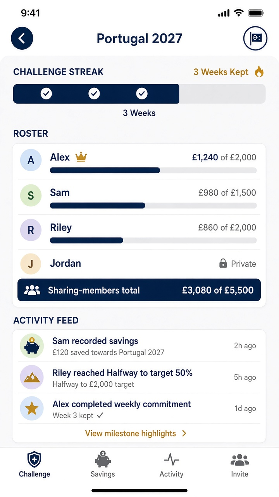

# Gate 2.2 — Static study: Challenge activity & roster (mobile)

| Field | Value |
| --- | --- |
| Gate | 2.2 — Visual Identity Exploration |
| Fidelity | Static visual study |
| Direction | A+B approved |
| Sample data | Reconciled synthetic · self-reported |

---

## 1. Intent

Challenge as a **crew board**: shared purpose + independent personal targets, event-generated activity. Consistency over wealth comparison.

---

## 2. Visual study — A+B

### Layout reading order

1. Challenge title + shared purpose  
2. **Personal streak / commitment strip** — streak **3 weeks** (B — before feed)  
3. **Roster** — personal figures where sharing; Private where not  
4. **Sharing-member total** — £3,080 of £5,500 labelled  
5. **Activity feed** — approved MVP event types only  

### Roster (reconciled → sharing-member total)

| Member | What others see |
| --- | --- |
| Alex (you) | £1,240 of £2,000 |
| Sam | £980 of £1,500 |
| Riley | £860 of £2,000 |
| Jordan | **Private** — lock; **no** amount; **no** target (G1.1-06) |
| **Sharing-member total** | **£3,080 of £5,500** (excludes Jordan) |

One privacy setting hides amounts **and** target. Private members remain listed without leaking monetary values (G1.1-06).

### Feed events (approved MVP patterns)

- Contribution recorded (amount only if sharing)  
- Weekly commitment completed  
- Milestone — “Halfway to target” (G1.1-08)  
- Joins / challenge lifecycle as scoped in product docs  

No amount-based leaderboard. No invented pause/resume behaviour in feed copy.

---

## 3. Optional exploration only — not MVP

Encourage on a feed row, if shown: **Optional exploration only — not MVP.**

---

## 4. Open

- Feed concatenation for noisy join events — **OPEN — requires product-owner approval.**  
- Roster density on small screens — **OPEN — requires product-owner approval.**
