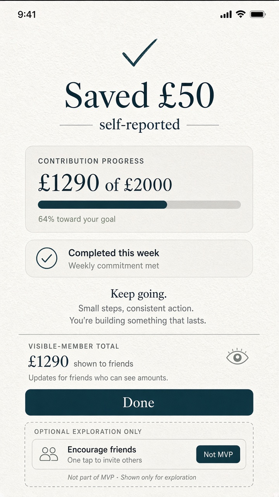

# Gate 2.2 — Static study: Contribution confirmation (mobile)

| Field | Value |
| --- | --- |
| Gate | 2.2 — Visual Identity Exploration |
| Fidelity | Static visual study |
| Sample data | Synthetic · self-reported |
| Primary direction shown | A+B hybrid |

---

## 1. Intent

Confirm an eligible self-reported contribution with fintech clarity (what changed) and social warmth (momentum), without implying bank custody or verified deposits.

Atomic action → personal progress + weekly commitment + (privacy-respecting) activity — Strava-loop mapping from research, applied to approved MVP contribution.

---

## 2. Visual study — A+B

### Hierarchy

1. **Confirmation amount** — Saved £50 · **Self-reported**  
2. **Personal progress update** — e.g. toward £1,290 of £2,000  
3. **Weekly commitment chip** — Completed this week (icon + text)  
4. Supportive, non-punitive copy  
5. Secondary note that visible-member totals update for friends who can see amounts (G1.1-06)  
6. Primary **Done** CTA (Deep Sea)

### Tone

- Soft confirmation (A) + clear success state (B)  
- No vault / banking-terminal chrome (P10)  
- Milestone celebration uses scarce accent only when a threshold is crossed (G1.1-08)

---

## 3. Optional exploration only — not MVP

The study may include a clearly labelled **Encourage friends** one-tap control.

**Required label:** *Optional exploration only — not MVP.*

Not an MVP requirement; must not expand Gate 1 scope.

---

## 4. Accessibility notes (planned)

- Success must not rely on colour alone  
- Focus moves to confirmation heading / Done in interactive prototypes (**needs interactive prototype**)  
- Motion: short fill/pulse with reduced-motion static check state (PRS §10.1)

---

## 5. Open

- Exact post-confirm navigation (stay vs return to dashboard) — **OPEN — requires product-owner approval.**  
- Whether Encourage appears at all beyond exploration — **OPEN — requires product-owner approval** (still not MVP).
