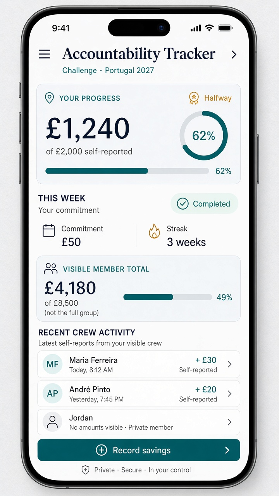
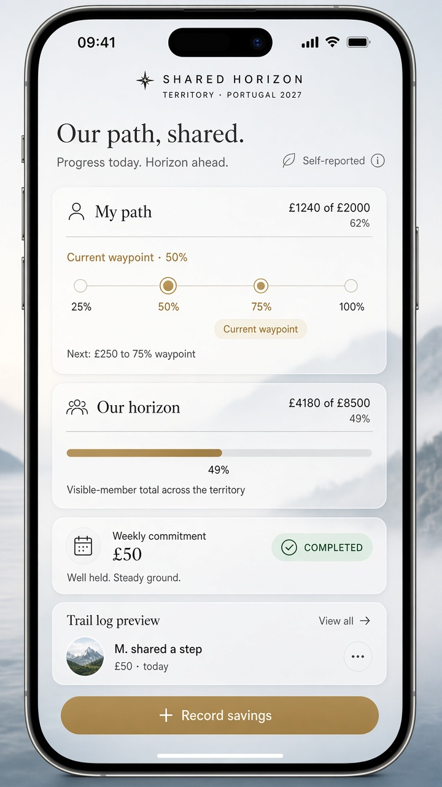

# Gate 2.2 — Static study: Challenge dashboard (mobile)

| Field | Value |
| --- | --- |
| Gate | 2.2 — Visual Identity Exploration |
| Fidelity | Static visual study — **not** wireframes / mid-fi system |
| Sample data | Synthetic · self-reported |
| Stop | Direction decision only — do not treat as build spec |

---

## 1. Hierarchy (must read in this order)

1. **Personal progress** — £1,240 of £2,000 · Self-reported  
2. **Weekly commitment** — £50 · status chip (baseline: Completed) + streak  
3. **Shared / visible-member total** — £4,180 of £8,500 · labelled **Visible members only** (G1.1-06)  
4. **Shared activity preview** — event-generated, privacy-respecting  

Maps to competitor research recommendation: personal status before social scroll (`docs/design/research/competitor-analysis.md` §3.4).

---

## 2. Primary study — A+B hybrid

**Clear Companions (A) contributions**

- Large calm personal amount; muted supporting labels
- Horizontal progress track; Deep Sea fill (scarce accent)
- Quiet chrome around money

**Crew Momentum (B) contributions**

- Commitment / streak strip before activity
- Honey Amber only on milestone mark (Halfway)
- Crew feed as living proof, not a separate “social product”

**Privacy**

- Jordan appears as a member with **Private** lock chip — no amount/target exposed (G1.1-06)
- Group total caption prevents “full group” misread

---

## 3. Comparable study — Shared Horizon (C)

Same sample content. Dual composition: **My path** vs **Our horizon (visible members)** with waypoint marks at 25/50/75/100%. Atmosphere is secondary to amounts.

---

## 4. Annotations

| Region | Design intent | Product rule |
| --- | --- | --- |
| Hero amount | Trust Before Decorations | Self-reported honesty (P10 / PRS) |
| Commitment chip | Habit loop clarity | G1.1-03 |
| Visible-member total | Explicit scope label | G1.1-06 |
| Halfway mark | Named personal milestone | G1.1-08 |
| Private roster presence | Person ≠ missing data bug | G1.1-06 |
| Record savings CTA | Primary thumb action | Approved MVP contribution |

---

## 5. Open

- Final progress control (bar vs path/waypoints) — **OPEN — requires product-owner approval.**
- Exact IA labels for bottom nav — see `flows-navigation.md` — **OPEN — requires product-owner approval.**
