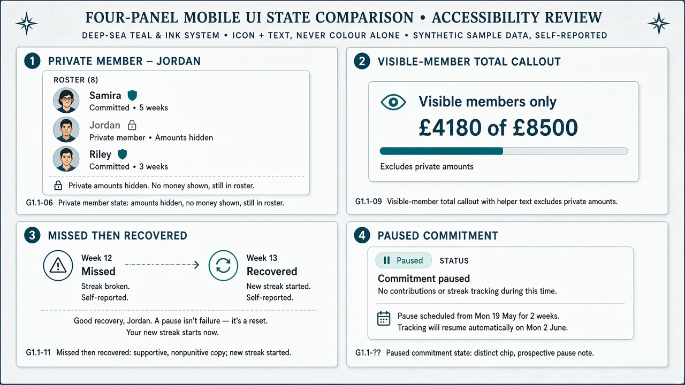

# Gate 2.2 — State & accessibility review

| Field | Value |
| --- | --- |
| Gate | 2.2 — Visual Identity Exploration |
| Accessibility target | PRS §10.1 — **WCAG 2.2 AA** |
| Sample data | Synthetic · labelled **Self-reported** |
| Interactive prototype | Not in this gate — checks flagged below |

---

## 1. State panel artifact

---

## 2. Critical UI states (viewer visibility)

Shared cast: Challenge **Portugal 2027** · Viewer **Alex** · Members Alex, Sam, Riley, **Jordan (private)** · amounts self-reported.

### 2.1 Private member (Jordan)

| Aspect | Treatment |
| --- | --- |
| What Alex sees | Jordan’s name/avatar + **Private** lock chip · **no** amount · **no** target |
| What Jordan sees (own device) | Full own financials |
| Group total | Jordan excluded from aggregates shown to others |
| Governing rules | **G1.1-06** (also PRS §7 privacy model) |
| Design guard | Person remains in roster — not an empty hole that implies a bug or leaks via inference |

### 2.2 Visible-member total

| Aspect | Treatment |
| --- | --- |
| Label | **Visible members only** (never “Group total” alone) |
| Sample | £4,180 of £8,500 |
| Scope | Sum of sharing members’ contributions/targets only |
| Governing rules | **G1.1-06** |
| Helper copy (study) | “Excludes members who hide amounts and targets.” |

### 2.3 Missed → recovered commitment

| Aspect | Treatment |
| --- | --- |
| History | Missed week remains marked **Missed** (historical) |
| Next success | **Recovered / New streak started** — automatic; no manual reset |
| Tone | Supportive, non-punitive |
| Governing rules | **G1.1-09** |
| Must not | Retroactively rewrite miss as completed unless authorised correction changes that period |

### 2.4 Paused commitment

| Aspect | Treatment |
| --- | --- |
| Chip | **Paused** — visually distinct from Completed and Missed |
| Timing | Prospective — starts next weekly period |
| Meaning | Not a successful savings week; not a miss |
| Governing rules | **G1.1-11** |
| Open product detail | Max pause duration / resume behaviour — **OPEN — requires product-owner approval** |

### Related milestone state (cross-check)

| Aspect | Treatment |
| --- | --- |
| Thresholds | 25 / 50 / 75 / 100% of **individual** target |
| Sample | Halfway at 50% |
| Privacy | Milestone activity shown to others only per privacy |
| Governing rules | **G1.1-08** |
| Open | Exact streak milestone thresholds — **OPEN — requires product-owner approval** |

---

## 3. Planned WCAG 2.2 AA checks

| Area | Planned check | Static study now | Needs interactive prototype |
| --- | --- | --- | --- |
| Contrast | Text/icon vs surfaces ≥ AA (normal 4.5:1; large/UI 3:1 where applicable); Deep Sea / Ink / Mute pairs documented in moodboards | Partial — role table in `moodboard-ab.md` | Yes — theme tokens on real components |
| Non-colour status | Completed / Missed / Recovered / Paused / Private always icon + text | Shown in panels | Yes — live chip component review |
| Keyboard / focus | Tab order; visible focus on CTA, toggles, roster rows | Not testable statically | **Yes — required** |
| Labels / SR | Accessible names for amounts (“£1,240 of £2,000, self-reported”); private rows announce Private without fabricating amounts; visible-member totals named with scope | Copy planned | **Yes — required** |
| Validation | Contribution form errors programmatic + text | Not in this study | **Yes — required** |
| Motion alternatives | Progress fill / milestone pulse off under `prefers-reduced-motion`; equivalent static feedback | Described | **Yes — required** |
| Text resize | Amounts remain legible under OS text scaling; avoid clipped hero numerals | Risk noted | **Yes — required** |
| Target size | Primary Record / Done controls thumb-friendly | Suggested in layouts | Yes |

Do **not** invent a higher/lower accessibility bar than WCAG 2.2 AA. Testing methodology remains an open product decision in the PRS — **OPEN — requires product-owner approval** (methodology only; target is fixed).

---

## 4. Viewer matrix (quick reference)

| Viewer | Sees Alex amounts | Sees Jordan amounts | Sees visible-member total |
| --- | --- | --- | --- |
| Alex (self) | Yes | No (Jordan private) | Yes (scope-labelled) |
| Sam (sharing) | Yes (Alex sharing) | No | Yes (excludes Jordan) |
| Jordan (private) | Yes (Alex sharing) | Yes (own) | Yes as labelled aggregate of sharers |

Inference via aggregate differences in small groups — product edge case **OPEN — requires product-owner approval** (Gate 1.1 remaining opens). Design must not encourage UI patterns that make subtraction trivial (e.g. toggling one private member against an otherwise full total without care).

---

## 5. Spec-safety

- No new MVP requirements introduced  
- Optional Encourage control, if pictured elsewhere, remains **optional exploration only — not MVP**  
- Gate 1 / Gate 1.1 product docs were not modified
