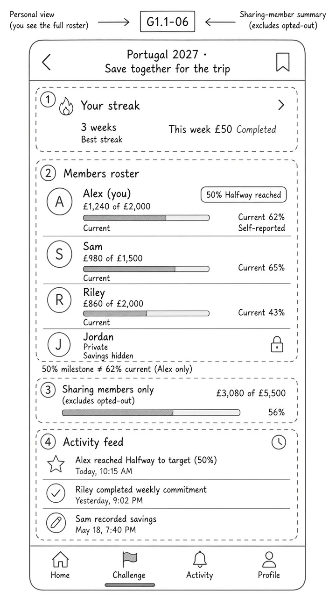

# Wireframes — Challenge activity & roster (mobile)

| Field | Value |
| --- | --- |
| Pass | A+B mobile wireframes — correction before PO sign-off |
| Fidelity | Low / annotated wireframe — **not** mid-fi |
| Direction | A+B; C as personal vs sharing-member reference |
| Viewport | Mobile only |
| Sample | Synthetic · self-reported |

---

## Artifact

Path: `/cursor/stores/bc-01a1cb7f-3748-76b6-a0c6-6560b08a6ca8/media/wireframes/challenge-activity.jpg`

---

## Reading order

| # | Region | Content |
| --- | --- | --- |
| 1 | Challenge header | Portugal 2027 · Save together for the trip |
| 2 | **Your streak** / commitment strip | **3 weeks** · This week £50 Completed — **before** feed |
| 3 | **Roster** | Personal figures where sharing; opted-out as Private |
| 4 | **Sharing-member total** | £3,080 of £5,500 · **Sharing members only** (Alex+Sam+Riley; excludes Jordan) |
| 5 | **Activity feed** | Approved MVP event types only |

Bottom nav: **Home · Challenge · Activity · Profile** — **no Leaderboard**.

---

## Roster (canonical)

| Member | What others see |
| --- | --- |
| Alex (you) | £1,240 of £2,000 · **Current 62%** · Self-reported · separate **50% Halfway · reached** |
| Sam | £980 of £1,500 · **Current 65%** · bar ~65% · **no** Halfway chip |
| Riley | £860 of £2,000 · **43%** · **not** a 50% milestone |
| Jordan | **Private** · lock · **no** amount · **no** target |
| **Sharing-member total** | **£3,080 of £5,500** (Alex+Sam+Riley contributions/targets; excludes Jordan) |

### Image correction note

If the artifact ever reads “Best streak,” treat canonical label as **Your streak**. Halfway recognition belongs to **Alex only** (past 50% at 62% current). Sam percentage is **65%** (£980 of £1,500).

---

## Feed events (sample-consistent)

- **Alex** reached Halfway to target (**50%**) — G1.1-08
- **Riley** completed weekly commitment — not a progress milestone
- **Sam** recorded savings (amount only if sharing)

No amount-based leaderboard. No invented pause/resume feed copy.

---

## Out of scope on this screen

- **Encourage / kudos** — optional exploration only if shown as a separately labelled non-MVP card; **omitted** from this wireframe.
- Pause **duration** / **resume** — status-only elsewhere; not invented here (G1.1-11).

---

## Open

- Feed concatenation for noisy join events — **OPEN — requires product-owner approval.**
- Roster density on small screens — **OPEN — requires product-owner approval.**
