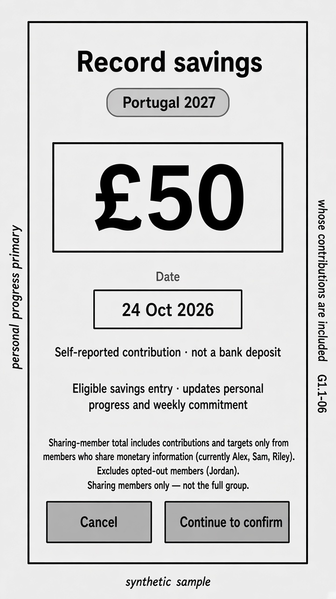
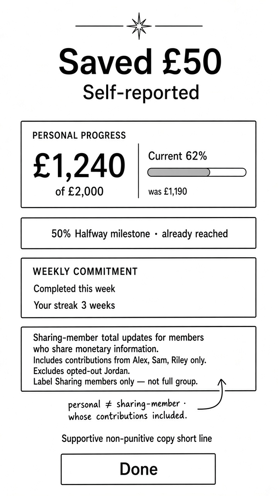

# Wireframes — Contribution flow (mobile)

| Field | Value |
| --- | --- |
| Pass | A+B mobile wireframes — correction before PO sign-off |
| Fidelity | Low / annotated wireframe — **not** mid-fi |
| Direction | A+B |
| Viewport | Mobile only |
| Sample | Synthetic · self-reported · confirm beat reconciled |

---

## Artifacts

### Step A — Amount entry



Path: `/cursor/stores/bc-01a1cb7f-3748-76b6-a0c6-6560b08a6ca8/media/wireframes/contribution-amount.jpg`

| Element | Wireframe treatment |
| --- | --- |
| Title | Record savings |
| Challenge | Portugal 2027 |
| Amount | **£50** (primary) |
| Date | Within permitted period (sample date only) |
| Labelling | **Self-reported** · not a bank deposit |
| Helper | Updates personal progress + weekly commitment |
| **Sharing-member total explainer** | Includes contributions and targets **only from members who share monetary information** (sample: **Alex, Sam, Riley**). **Excludes** opted-out members (**Jordan**). Label: **Sharing members only** — not the full group. |
| Actions | Cancel · Continue to confirm |

No invented backdating / week-allocation UI (G1.1-05 open items remain open).

### Step B — Confirmation



Path: `/cursor/stores/bc-01a1cb7f-3748-76b6-a0c6-6560b08a6ca8/media/wireframes/contribution-confirm.jpg`

### Confirm hierarchy (reconciled beat)

| # | Beat | Content |
| --- | --- | --- |
| 1 | Confirmation amount | Saved **£50** · **Self-reported** |
| 2 | Personal progress | Now **£1,240 of £2,000** · **Current 62%** (from £1,190) |
| 2b | Milestone (separate) | **50% Halfway milestone · already reached** — not conflated with 62% |
| 3 | Weekly commitment | Completed this week · **Your streak · 3 weeks** |
| 4 | **Sharing-member total explainer** | Updates for members who share monetary information. Includes contributions from **Alex, Sam, Riley only**. Excludes opted-out **Jordan**. Label **Sharing members only** — not full group. Distinct from personal figures. |
| 5 | Tone | Supportive, non-punitive (placeholder copy in wireframe) |
| 6 | CTA | **Done** |

Encourage / kudos **omitted** (optional exploration only — not MVP).

---

## Flow

```
Home / Challenge → Record savings
  → Amount + date (within permitted period)
  → Confirm eligibility (G1.1-05)
  → Success (this confirm hierarchy)
  → Updates: personal progress, commitment assessment, milestones, activity (privacy-aware)
```

---

## Open

- Exact post-confirm navigation — **OPEN — requires product-owner approval.**
- Contribution backdating / week allocation — **OPEN — requires product-owner approval.**
