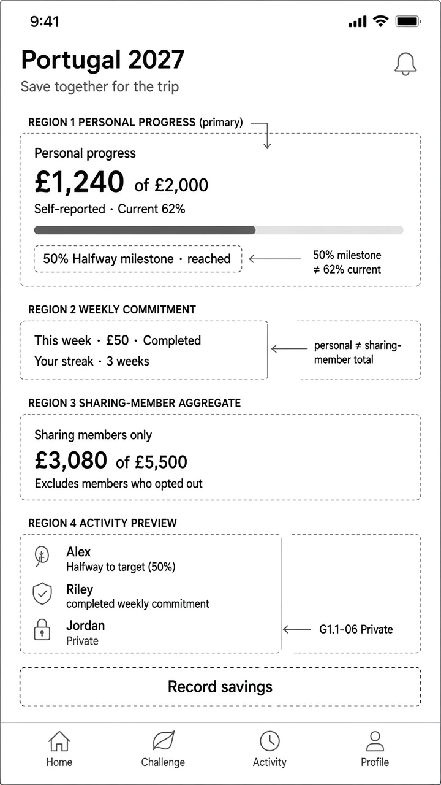

# Wireframes — Dashboard (mobile)

| Field | Value |
| --- | --- |
| Pass | A+B mobile wireframes — authorised structure pass |
| Fidelity | Low / annotated wireframe — **not** mid-fi |
| Direction | Clear Companions (A) + Crew Momentum (B); C retained for personal vs sharing-member labelling |
| Viewport | Mobile only |
| Sample | Synthetic · self-reported · reconciled Gate 2.2 set |

---

## Artifact

Path: `media/wireframes/dashboard-home.jpg` (checkout); embed via `../../media/wireframes/dashboard-home.jpg`

---

## Reading order (hierarchy)

| # | Region | Content | Rule |
| --- | --- | --- | --- |
| 1 | **Personal progress** | £1,240 of £2,000 · **Current 62%** · Self-reported · progress bar | Trust Before Decorations; self-reported |
| 1b | **Milestone recognition (separate)** | **50% Halfway milestone · reached** — chip/row distinct from the 62% current readout | G1.1-08 — do not merge 50% recognition into 62% current |
| 2 | **Weekly commitment** | This week · £50 · Completed · **Your streak · 3 weeks** | G1.1-03; label is **Your streak** (not “Challenge streak”) |
| 3 | **Sharing-member aggregate** | £3,080 of £5,500 · labelled **Sharing members only** · excludes opted-out | G1.1-06; C reference for personal ≠ aggregate naming |
| 4 | **Activity preview** | Event-generated, privacy-filtered | Privacy-respecting feed |
| — | Primary CTA | **Record savings** | Approved MVP contribution entry |
| — | Bottom nav (proposal) | Home · Challenge · Activity · Profile | Exact labels/count **OPEN** |

---

## Annotations to protect

- **50% milestone ≠ 62% current** — Halfway recognition is a separate beat from current progress percentage.
- **Personal ≠ sharing-member total** — never bare “Group total.”
- **Jordan · Private** — lock + no amount + no target (G1.1-06 opt-out).
- Default visibility is to **approved challenge members**; this screen does not claim private-by-default.
- Working accents Deep Sea / Honey Amber may be noted later; this wireframe stays grayscale / lightly annotated.
- No invented pause duration / resume UI.

---

## Open (do not invent)

- Final progress control (bar vs path) — **OPEN — requires product-owner approval.**
- Exact IA tab labels / count — **OPEN — requires product-owner approval.**
