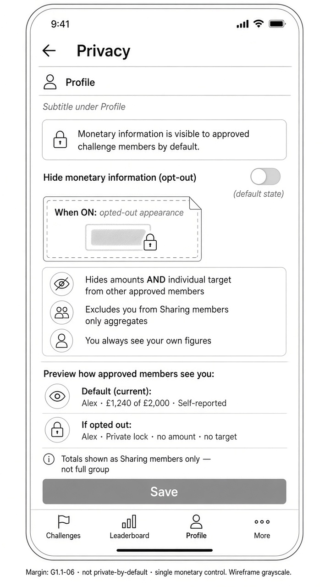
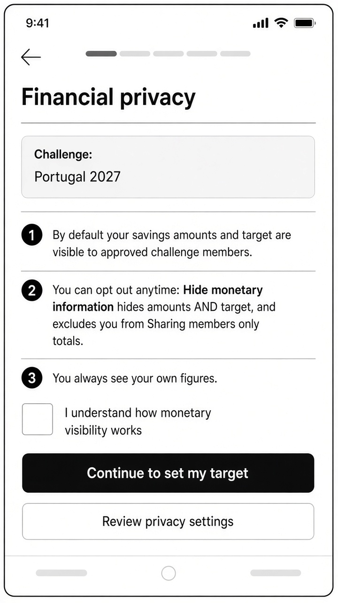

# Wireframes — Privacy settings & disclosure (mobile)

| Field | Value |
| --- | --- |
| Pass | A+B mobile wireframes — authorised structure pass |
| Fidelity | Low / annotated wireframe — **not** mid-fi |
| Rule | G1.1-06 (privacy / sharing-member totals); G1.1-07 (invite preview constraints) |
| Viewport | Mobile only |

---

## Artifact A — Privacy settings (one monetary control)



Path: `media/wireframes/privacy-settings.jpg` (checkout); embed via `../../media/wireframes/privacy-settings.jpg`

### Structure

| Block | Treatment |
| --- | --- |
| Default copy | Monetary information is visible to **approved challenge members** by default |
| Control | **One** toggle: **Hide monetary information (opt-out)** — default **OFF** |
| When ON | Hides **amounts AND individual target**; excludes member from **Sharing members only** aggregates |
| Self view | User always sees own authorised financial information |
| Preview | Default: Alex · £1,240 of £2,000 · Self-reported · Opted out: Alex · Private · no amount · no target |
| Totals labelling | **Sharing members only** — not full group |
| Save | Applies across feed, exports, notifications (product rule) |

### Must not

- Say “private by default” or imply opt-in-to-share as the default
- Offer separate toggles for amounts vs targets
- Invent small-group aggregate edge-case UI (open product question)

### Image correction note

Bottom nav in the artifact may vary; canonical working proposal remains **Home · Challenge · Activity · Profile** (exact labels **OPEN**). No leaderboard tab in MVP wireframes.

---

## Artifact B — Join disclosure (before savings setup)



Path: `media/wireframes/privacy-disclosure-join.jpg` (checkout); embed via `../../media/wireframes/privacy-disclosure-join.jpg`

### Structure

| Block | Treatment |
| --- | --- |
| Context | Challenge name only (Portugal 2027) — invite preview never exposed amounts (G1.1-07) |
| Disclosure 1 | Default: amounts + target visible to approved challenge members |
| Disclosure 2 | Opt-out **Hide monetary information** hides amounts **and** target; excludes from Sharing members only totals |
| Disclosure 3 | You always see your own figures |
| Ack | Checkbox: I understand how monetary visibility works |
| Primary | Continue to set my target |
| Secondary | Review privacy settings |

### Image correction note

Any multi-step progress indicator is **illustrative only**. Exact join/setup step count remains **OPEN — requires product-owner approval.**

---

## Flow

```
Profile → Privacy
  → Default copy (approved challenge members)
  → Single opt-out: Hide monetary information
  → Explainer + roster/total preview
  → Save

Invite → Request join → Owner approval
  → Financial privacy acknowledgement (this disclosure)
  → Configure personal target + weekly commitment
  → Then recording savings is allowed
```
